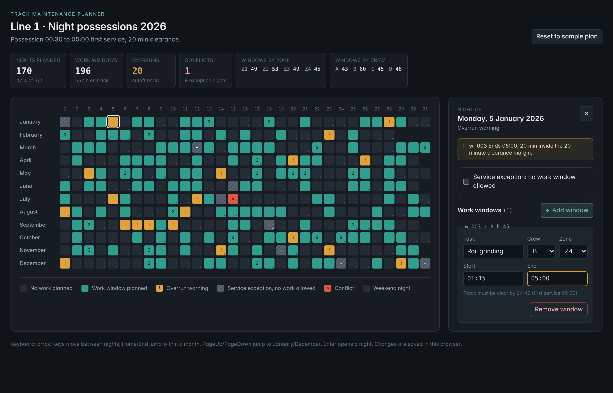

# Planning Calendar UI

A year-at-a-glance night-shift planning calendar for track maintenance. All 365 nights of a line's maintenance year sit on one screen; each night can hold one or more work windows (start and end time, crew, zone, task). The domain layer derives overrun warnings when a window runs past the service-start cutoff, flags conflicts on nights blocked by a service exception, and detects overlapping possessions in the same zone. A side panel inspects and edits the selected night, and every change recomputes the plan and persists locally. The point of the project is to show how a dense, data-heavy planning surface can stay fast, fully keyboard-operable and readable without relying on colour alone.



Live demo: `https://yatlagh.github.io/planning-calendar-ui/` (deployed from `main` by the included workflow).

## Features

- 12 month rows x 31 columns: the whole year in a single view with no scrolling at desktop widths.
- Work windows with start/end time, crew, zone and task; several windows per night.
- Overrun detection against the line's rules (possession start, first service, clearance margin) with warning and error severities.
- Service exceptions (holiday, special event, extended service, inspection blackout) that block a night; planning on one is reported as a conflict.
- Overlap detection for two crews booked into the same zone at the same time.
- Summary bar: planned nights, windows, hours on track, overruns, conflicts, tallies by zone and crew.
- Night panel to add, edit and remove windows and to toggle the exception for a night.
- Deterministic sample year (seeded PRNG) so the demo looks the same on every machine; edits persist in `localStorage` with a one-click reset.

## Architecture

```
src/
  domain/        Pure, framework-free model. No React imports.
    types.ts       Night, WorkWindow, ServiceException, Warning, LineRules, Summary
    time.ts        ISO date and minutes-after-midnight helpers (no timezone maths)
    overruns.ts    detectOverruns(): overrun, exception-conflict and overlap rules
    calendar.ts    buildYear(): 365/366 Night objects grouped into month rows
    summary.ts     summarize(): aggregates for the summary bar
  hooks/
    usePlanner.ts  Owns editable state, persists it, derives year + summary with useMemo
  components/
    YearGrid.tsx   ARIA grid with roving tabindex and arrow-key navigation
    NightCell.tsx  One night: status colour, glyph, accessible name
    NightPanel.tsx Inspect/edit the selected night (windows, exception, warnings)
    SummaryBar.tsx Stat tiles
    Legend.tsx     Status swatches with the same glyphs used in the grid
  data/
    sample.ts      Seeded generator for the demo plan and the line rules
```

Times are stored as minutes after 00:00 on the night's calendar date and may exceed 1440 (04:15 the next morning is 1695). Every rule is therefore an integer comparison, and the model never touches `Date` for anything but weekday and month length.

The domain functions are pure and ordered deterministically, which keeps them trivially testable and makes the year model cheap to rebuild on every edit (a few hundred objects, well under a millisecond).

## Accessibility

Built to WCAG 2.1 AA.

- The calendar is a WAI-ARIA `grid` with `row`, `rowheader`, `columnheader` and `gridcell` roles and a roving tabindex: one Tab stop, then arrow keys move between nights, Home/End jump within a month, PageUp/PageDown jump to January/December, Enter or Space opens a night.
- Every cell has an accessible name that reads the full date, status, window count and warning count, so a screen reader user gets the same information as the colour.
- Status is never colour-only: overruns carry a `!` glyph, conflicts an `x`, exceptions a hatched fill with a dash, and weekend nights a dot. The legend reuses the same glyphs.
- Cell text and glyphs meet 4.5:1 contrast on their fills; focus is a 2 px high-contrast ring on `:focus-visible`.
- Warnings for the selected night are announced through an `aria-live="polite"` region; invalid time input sets `aria-invalid` and is described by an inline error.
- `prefers-reduced-motion` disables the small hover and focus transitions.
- A skip link jumps straight to the calendar.

## Scripts

```
npm install
npm run dev          # Vite dev server
npm test             # Vitest + Testing Library (domain rules and grid interaction)
npm run build        # Type-check and production build to dist/
npm run preview      # Serve the production build
npm run screenshot   # Rebuild docs/screenshot.png with Playwright (after npm run build)
```

Deployment: `.github/workflows/pages.yml` runs the tests, builds and publishes `dist/` to GitHub Pages on every push to `main`. `vite.config.ts` sets `base` to `/planning-calendar-ui/` to match the project URL.

## Background

This is a self-contained reconstruction of a production planning tool I designed and built for a transit-maintenance client, reduced to the parts that matter for the UI: the year grid, the overrun rules and the night editor. Names, rules and data are fictional.

## License

MIT. See [LICENSE](LICENSE).
